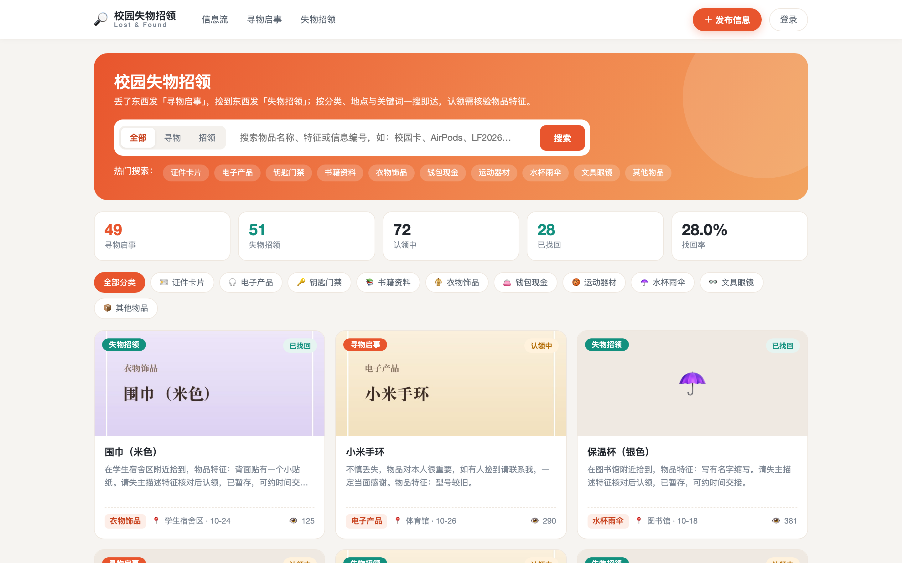
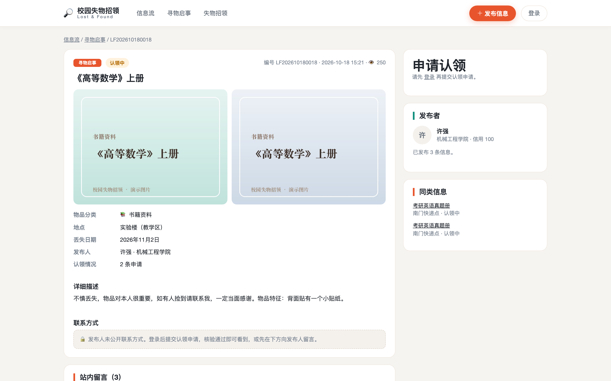
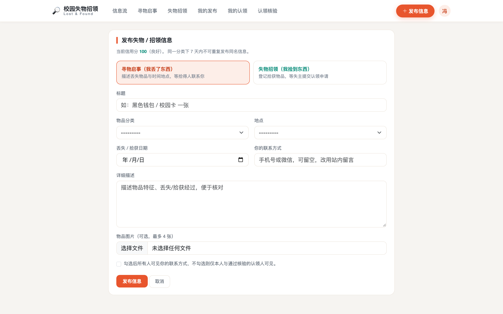
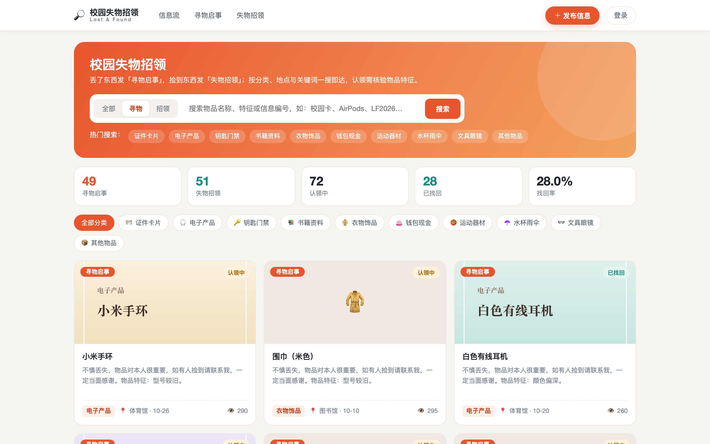
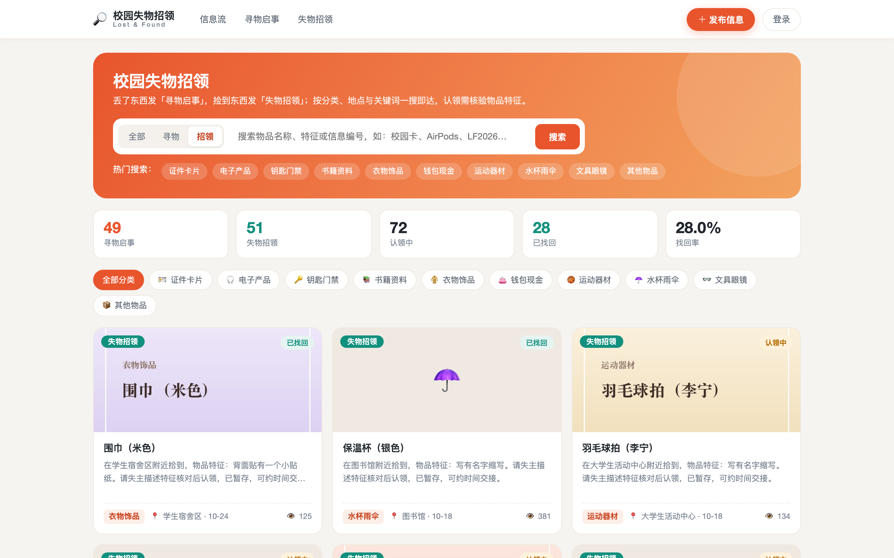
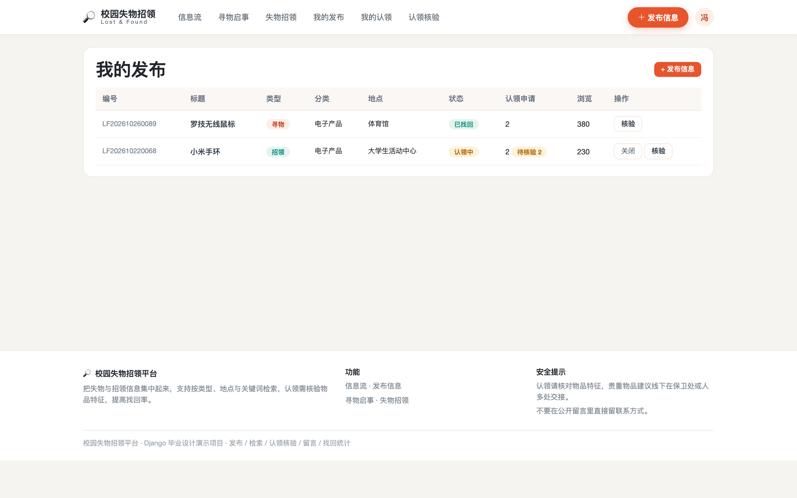
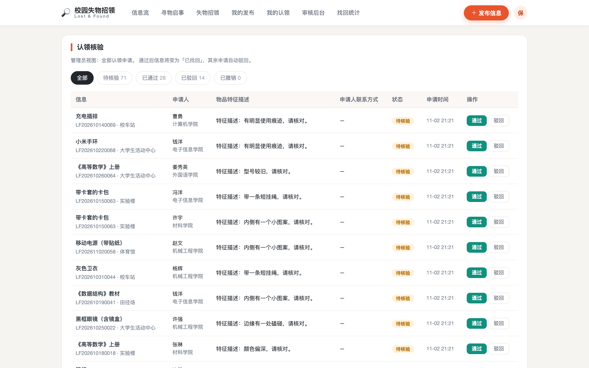
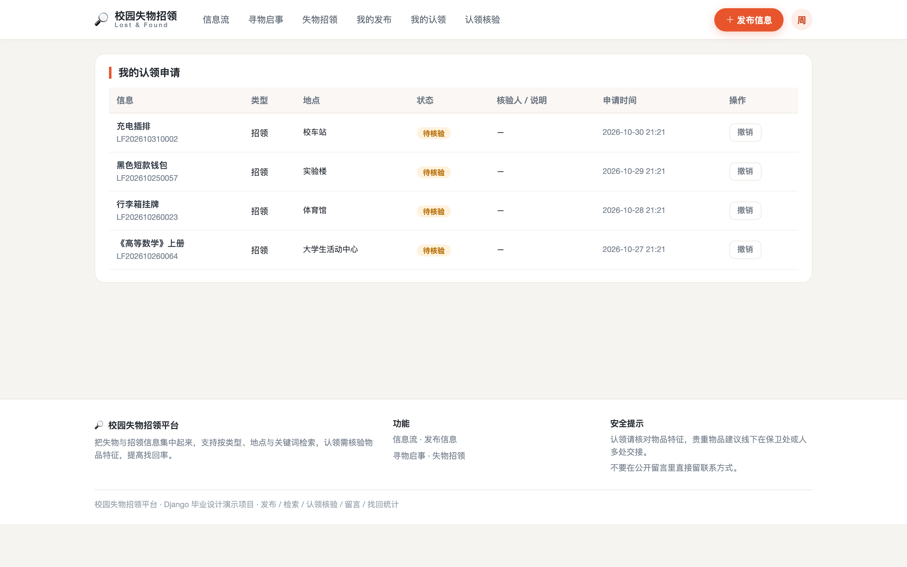
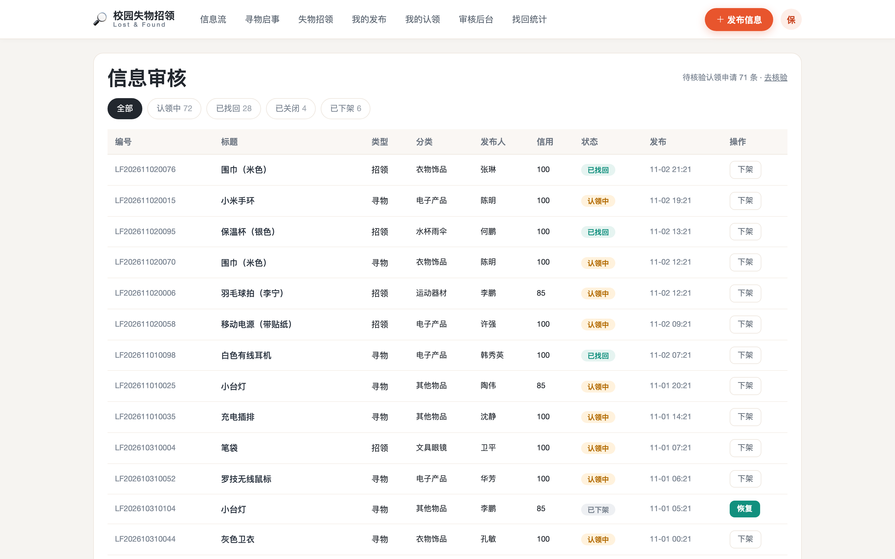
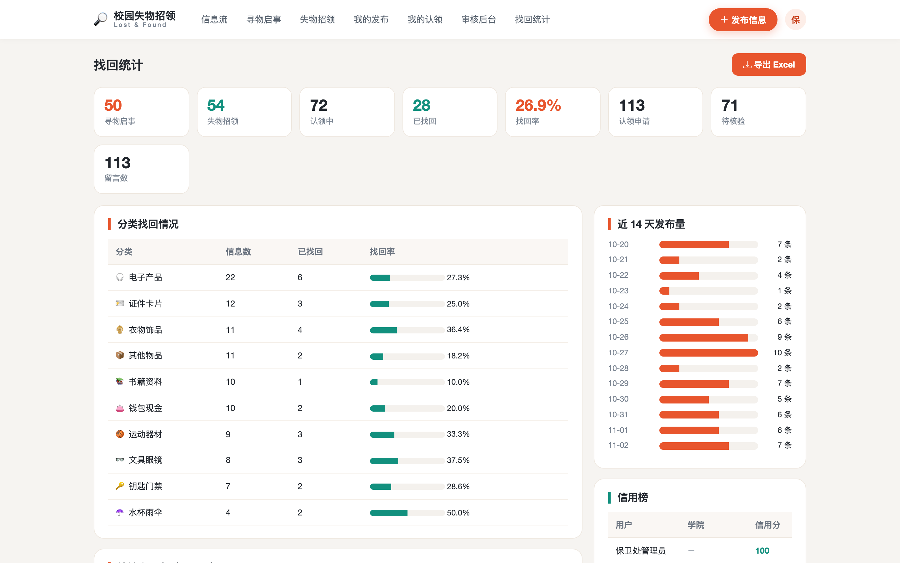

# 004 基于 Django 的校园失物招领平台-设计展示

> **代码有偿获取 可接受定制 微信联系方式: csbysj2020 或 ACE2487，备注(BS)**

> **完整源码与全套文档 · 在线自助获取 >>> [https://mbd.pub/o/bread/YZaWlJlyZQ==](https://mbd.pub/o/bread/YZaWlJlyZQ==)**

> **成品页（功能介绍 / 更多选题）>>> [https://bishe.suilang.net/products/django-lostfound](https://bishe.suilang.net/products/django-lostfound)**

> 

> 

## 视频

> **点击查看 >>> [https://www.bilibili.com/video/BV1L24P6rEBm/](https://www.bilibili.com/video/BV1L24P6rEBm/)**

## 项目简介

面向高校的失物招领信息平台：把「寻物启事」与「失物招领」集中发布与检索，按分类、地点与关键词组织，认领需填写物品特征并核验，联系方式默认不公开；配合信用分治理虚假与重复发布，并提供找回率统计与导出。

校园内物品遗失频繁发生，而失物招领信息长期分散在表白墙、班级群、公告栏与保卫处登记本上，存在信息零散、检索困难、认领缺少核验、虚假与重复信息难以治理等问题。

本项目设计并实现了一套基于 Django 的校园失物招领平台，采用 B/S 架构与 Django 的 MVT 模式开发，数据库使用 MySQL。

平台将「寻物启事」与「失物招领」两类信息统一建模，按物品分类、校园地点、时间与关键词组织检索，面向学生与管理员两类角色，实现了信息发布与检索、认领申请与特征核验、站内留言、信息审核与下架、信用分治理以及找回率统计与报表导出等功能。

本仓库为**设计展示**：包含项目说明、技术架构、实验结果与运行截图；完整源码、任务书、开题报告、毕业论文与使用说明可通过上方链接自助获取，成品页可查看更多选题，也可联系微信咨询定制。

## 功能特性

1. 用户与信用：学生 / 管理员两类角色，信用分记录（有效发布加分、虚假信息扣分）

2. 信息发布：寻物启事 / 失物招领两类信息，支持分类、地点、日期、多图与联系方式

3. 信息检索：按类型、分类、地点与关键词筛选，卡片式信息流 + 热门信息排行

4. 认领核验：申请人填写物品特征，发布者或管理员核验；通过后信息转为「已找回」并自动驳回其余申请

5. 敏感信息保护：联系方式默认不公开，仅发布者本人 / 管理员 / 已通过核验的认领人可见

6. 站内留言：信息下留言沟通线索，避免公开联系方式

7. 审核治理：信息审核与下架，虚假信息下架扣发布者信用分，7 天重复发布限制

8. 找回统计：找回率、分类与地点分布、发布趋势、信用榜，一键导出 Excel

## 技术架构

| 项目 | 说明 |
| --- | --- |
| 编程语言 | Python 3.8 及以上 |
| Web 框架 | Django 4.2 |
| 数据库 | MySQL 5.7 及以上 |
| 前端 | Bootstrap 5（已内置本地文件，离线可用，无需前端构建） |
| 图片处理 | Pillow（上传物品图片 / 生成演示占位图） |
| 报表导出 | openpyxl |
| 操作系统 | Windows / macOS / Linux |
| 启动方式 | 双击一键脚本，或 python manage.py runserver |

## 目录结构

以下为完整交付版的结构（本仓库仅作设计展示）：

```
django-lostfound/
├── 任务书/
│   └── 毕业设计任务书.docx
├── 开题报告/
│   └── 毕业设计开题报告.docx
├── 最终论文/
│   ├── 图/
│   │   ├── 图3-1_系统用例图.png
│   │   ├── 图4-1_系统架构图.png
│   │   ├── 图4-2_功能模块图.png
│   │   ├── 图4-3_信息状态机图.png
│   │   ├── 图4-4_数据库ER图.png
│   │   └── 图4-5_认领核验流程图.png
│   └── 基于Django的校园失物招领平台设计.docx
├── 源码/
│   ├── accounts/
│   │   ├── migrations/
│   │   ├── __init__.py
│   │   ├── admin.py
│   │   ├── apps.py
│   │   ├── decorators.py
│   │   ├── forms.py
│   │   ├── models.py
│   │   ├── urls.py
│   │   └── views.py
│   ├── claims/
│   │   ├── migrations/
│   │   ├── __init__.py
│   │   ├── admin.py
│   │   ├── apps.py
│   │   ├── models.py
│   │   ├── services.py
│   │   ├── urls.py
│   │   └── views.py
│   ├── items/
│   │   ├── management/
│   │   ├── migrations/
│   │   ├── __init__.py
│   │   ├── admin.py
│   │   ├── apps.py
│   │   ├── forms.py
│   │   ├── models.py
│   │   ├── services.py
│   │   └── …
│   └── …
└── …
```

## 数据与实验结论

- 审核治理：信息审核与下架，虚假信息下架扣发布者信用分，7 天重复发布限制
- 用户与信用：学生 / 管理员两类角色，信用分记录（有效发布加分、虚假信息扣分）
- 信息发布：寻物启事 / 失物招领两类信息，支持分类、地点、日期、多图与联系方式

## 交付内容

1. 完整源码（已跑通，含 110 条信息 / 约 80 张演示图片 / 113 条认领申请演示数据）
2. 毕业设计任务书（Word）
3. 开题报告（Word）
4. 毕业论文（Word，七章制，含图表）
5. 系统使用与二次开发说明（Word + md）
6. 10 张系统运行截图

## 常见问题

**项目能直接跑起来吗？**

能。源码里已带数据库与演示数据（含物品占位图），安装依赖后双击一键脚本或按说明启动即可。

**数据是怎么来的？**

本系统是校内信息平台，失物与招领信息属于业务录入数据，不存在公开第三方数据源；演示数据由 seed_data 按真实业务规则程序生成，物品图片用 Pillow 生成占位图（固定随机种子，可复现）。

**认领怎么保证不被冒领？**

认领人必须填写只有真正失主/拾得人才知道的物品特征，由发布者或管理员核验；通过后信息变「已找回」并自动驳回其余申请，同时给双方加信用分。

**联系方式会不会泄露？**

默认不公开，只有发布者本人、管理员与「认领申请已通过」的申请人能看到，由模型的 contact_for() 统一控制。

**虚假信息怎么处理？**

管理员可下架信息，系统自动扣发布者 10 分信用分；同一用户 7 天内不能重复发布同名同类信息，信用分低于 60 不能发布。

**网站文字、颜色怎么改？**

页面在 templates/ 目录，配色在 static/css/style.css 顶部的变量（珊瑚橙=寻物、青绿=招领）；《系统使用与二次开发说明》里给了逐处对照表。

## 截图











